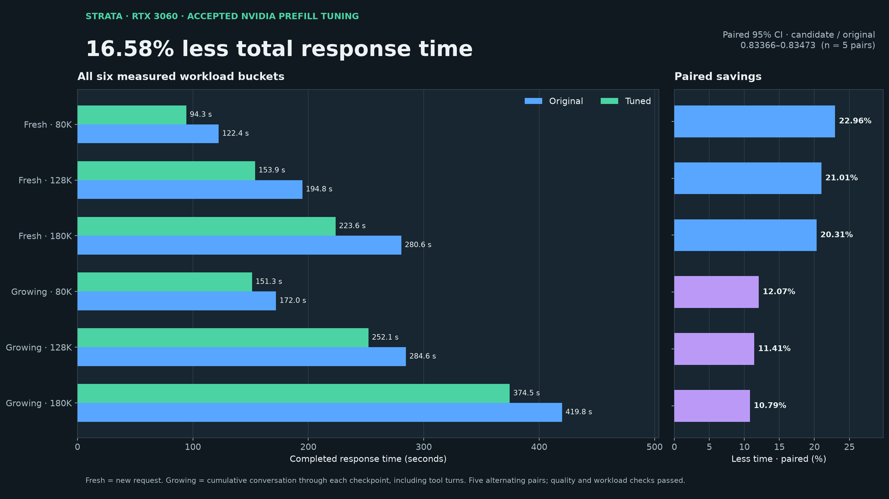
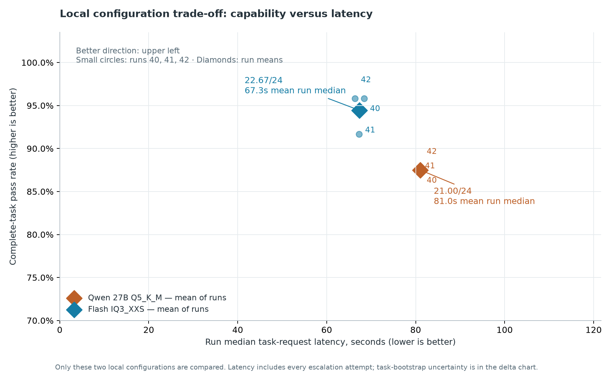
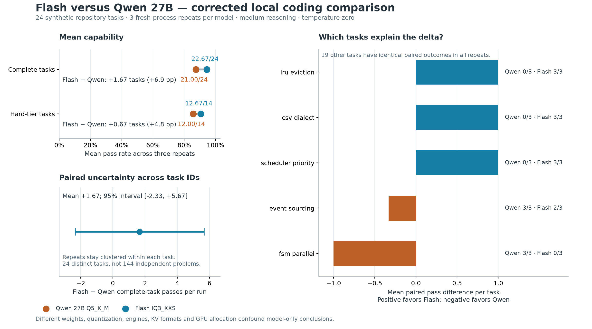

# Running Qwen3.8-Flash-Next on an RTX 3060

This is my October 12, 2026 snapshot of **UnbiasedStrata**, tuned for one **RTX 3060 with 12 GB VRAM**, a **Ryzen 9 7950X**, and **64 GB RAM**. It includes the source changes, a ready-to-edit NVIDIA profile, setup instructions, and the evidence behind the results.

The model used by this fork is **Qwen3.8-Flash-Next GSQ-RCO, IQ3_XXS**. The main result: the tuned settings took **16.58% less time** to finish the tested long-context workloads, with the same model and quality checks and the GPU kept at **100 W**.

[Get started](docs/QUICKSTART.md) · [Download and prepare the model](docs/MODELS.md) · [Download the dated snapshot and patch](https://github.com/AIMDaAlien/UnbiasedStrata-RTX3060/releases/tag/rtx3060-2026-10-12)

## Which models are we talking about?

**Both models in the comparison are Qwen3.8 variants.** “Flash” and “Qwen” in the archived charts are shorthand for these specific models and local setups:

| | Model used by this fork | Comparison model |
| --- | --- | --- |
| Full model name | **Qwen3.8-Flash-Next GSQ-RCO** | **Swift Qwen3.8 27B** |
| Weight format | **IQ3_XXS** | **Q5_K_M** |
| Chart label | “Flash IQ3_XXS” | “Qwen 27B Q5_K_M” |
| Runtime | UnbiasedStrata | llama.cpp build 10809 |
| Devices in the comparison | RTX 3060 + CPU, 12 threads | RX 9060 XT + RTX 3060 |
| Context capacity | 196,608 tokens | 131,072 tokens |
| Context-memory format | int8, with 32,768 tokens kept on the GPU | q4_0 |
| Draft tokens per speculative step | 4 | 2 |

IQ3_XXS and Q5_K_M are different ways of compressing model weights. These results compare the complete setups above, so differences cannot be attributed to the model alone.

Exact model filenames:

- **This fork:** `Qwen3.8-Flash-Next-GSQ-RCO-IQ3_XXS-00001-of-00002.gguf` and `Qwen3.8-Flash-Next-GSQ-RCO-IQ3_XXS-00002-of-00002.gguf`.
- **Comparison:** `Swift-Qwen3.8-27B-Q5_K_M.gguf`.

The Flash-Next setup also needs a prepared model pack and MTP draft head. [Model preparation](docs/MODELS.md) lists the required files, sources, checksums, and a known limitation in the original draft-head source record. Model weights and prepared packs are not included in this repository.

## Faster responses with long conversations

This test compares **Qwen3.8-Flash-Next GSQ-RCO IQ3_XXS before and after tuning**. The model, saved prompts, context capacity, quality checks, and power cap stayed the same.



A fresh request with **180,000 input tokens** finished in about **3 minutes 44 seconds**, down from **4 minutes 41 seconds**. A growing conversation through the same checkpoint took about **6 minutes 15 seconds**, down from **7 minutes**. Growing-conversation times include the earlier turns and tool calls.

Across all six workloads, the combined improvement was **16.58%**, using the geometric mean of the paired time ratios. Five alternating before/after pairs passed the retrieval, code, completion, token-count, tool-call, prefix-reuse, and no-swap checks. The 95% interval corresponds to **16.53–16.63% less time** on these saved workloads and this machine.

The accepted settings combine fused prefill, a 16,384-token chunk ceiling, and a 512-slot transfer ring. In plain language, they change how the engine processes a long prompt and moves expert weights to the GPU. They were tested together, so the result does not assign a separate percentage gain to each setting.

[Chart data](docs/assets/strata-rtx3060-showcase/accepted-response-times.csv) · [Acceptance decision](docs/assets/strata-prefill-20261010/decision.json) · [Detailed tuning note](docs/notes/Strata%20RTX%203060%20long-context%20tuning.md)

## How the two Qwen3.8 setups compared on coding tasks

Each setup attempted the same **24 synthetic repository tasks three times**, with medium reasoning and matching task budgets. Every one of the 144 saved answers was independently regraded.

**Qwen3.8-Flash-Next GSQ-RCO IQ3_XXS averaged 22.67 tasks passed out of 24. Swift Qwen3.8 27B Q5_K_M averaged 21 out of 24.** The Flash-Next setup also had lower typical request times in this comparison.



Here, **blue means Qwen3.8-Flash-Next GSQ-RCO IQ3_XXS** and **orange means Swift Qwen3.8 27B Q5_K_M**. Moving upward means more tasks passed; moving left means faster answers. Small circles show the three runs; diamonds show their averages.

The observed lead is **1.67 tasks per run**, but its task-bootstrap 95% interval runs from **−2.33 to +5.67 tasks** and includes zero. With only 24 distinct tasks, this comparison does not establish a reliable general advantage.



The models used different weight compression, runtimes, context-memory settings, speculative decoding, and GPU allocation. Read these as results for the named local setups, rather than a ranking of Qwen3.8 models in general.

[Full comparison](docs/notes/2026-10-12%20Matched%20Qwen%2027B%20vs%20Flash%20DeepSWE2.md) · [Methods and artifacts](docs/notes/2026-10-12%20Matched%20Qwen%20vs%20Flash%20%E2%80%94%20Methods%20and%20artifacts.md)

## Experiments that did not earn a rollout

AMD assistance and the additional native expert-kernel and QSA candidates failed their response-time improvement gates. They remain optional experiments and are disabled in the recommended profile. A faster isolated kernel did not translate into faster complete answers. [Experiment details and rollback](docs/EXPERIMENTS.md) explain the accepted, rejected, and untested work separately.

## Source, credit, and scope

The engine comes from [Strata](https://github.com/Niko1221/Strata), by Niko1221 and the Strata contributors, through [UnbiasedStrata](https://github.com/robertkarl/UnbiasedStrata), whose frontend and packaging were added by robertkarl. This snapshot retains their licenses and attribution. AIMDaAlien's changes cover hardware profiles, frontend token counting and cache reporting, prefill tuning and instrumentation, buffer guards, optional AMD/kernel experiments, and documentation. AI agents assisted implementation and packaging; model licenses are separate.

This is a personal hardware experiment built on those existing runtimes. There is no commitment to support future models or track future upstream releases. Any future work can get its own dated snapshot.

- UnbiasedStrata base: `d0a44ea7e757c59fa35a78b4b98d0c4bb44ce2cf`.
- Pinned llama.cpp: `3cf03257f219afbe7334045ff7c6a06ac68c627d`.
- Default branch: `rtx3060-snapshot`; original dated release: `rtx3060-2026-10-12`.

[Ancestry](UPSTREAM.md) · [Packaging verification](snapshot/verification.json) · [Export checksums](docs/export-manifest.json)

## Keeping the notes available

The five selected Obsidian notes and their supporting charts and evidence are under [docs/notes](docs/notes). Existing results stay tied to their recorded executables; the successful packaging rebuild and API smoke check did not repeat the scored benchmarks.

To export those notes again on demand:

```sh
python3 scripts/export-notes.py --vault "$OBSIDIAN_VAULT"
python3 scripts/check-docs.py
```

The export converts wiki links and chart embeds, copies the selected assets, normalizes personal paths, and records original/exported checksums. It preserves the local originals. There is no background synchronization or automatic publishing. Archived evidence scripts are documentation snapshots; use the quick start for the runnable setup.
